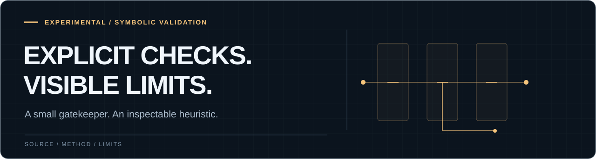

<p>
  
</p>

# Symbolic Validation Framework (SVN 1.2)

A small Python gatekeeper for text outputs, with symbol time-to-live,
a word-diversity heuristic, and caller-supplied reality and utility checks.

**Experimental prototype.** This implementation does not establish truth,
emotional safety, or prevention of recursive drift.

[Try the example](#try-the-example) · [What it checks](#what-it-checks) · [Known limitations](#known-limitations)

---

## Try the example

Python 3.7 or newer; standard library only.

```bash
git clone https://github.com/regsaddler/symbolic-validation-framework.git
cd symbolic-validation-framework
python3
```

Paste this into the Python interpreter:

```python
from symbolic_gatekeeper import SymbolicGatekeeper

# Illustrative callbacks, not factual verification.
def reality_check(output):
    return "falsehood" not in output.lower()

def utility_check(output):
    return len(output.split()) > 5

gatekeeper = SymbolicGatekeeper(reality_check, utility_check)
symbolic_text = "A myth in balance is a map, not a command."
result = gatekeeper.validate_symbolic_output("wisdom_quote", symbolic_text)
print(result)
```

Expected output:

```text
[ACCEPTED] Symbol 'wisdom_quote' stored.
True
```

The poetic example has high lexical diversity and is not treated as repetitive.
Acceptance only means the text passed these checks. The callbacks above cannot
determine whether an idea is true or useful.

## What it checks

| Step | Current behavior |
| --- | --- |
| Existing symbol | Removes an expired entry when the same label is validated again |
| Word diversity | Rejects text whose unique-word ratio is below `0.25` by default |
| Reality callback | Applies the function supplied by the caller |
| Utility callback | Applies the function supplied by the caller |
| Accepted result | Stores the text under its label with a default lifetime of 600 seconds |

The `lexical_diversity` function computes unique whitespace-separated words
divided by total words. The old `semantic_entropy` name remains as a
compatibility alias. Neither compares meanings nor calculates Shannon entropy.
For answer clustering, see the separate
[semantic-entropy project](https://github.com/regsaddler/semantic-entropy).

---

## Known limitations

- Low word diversity can flag intentional repetition; the threshold is a
  caller-configurable heuristic, not evidence that a loop or failure occurred.
- Expiration is checked lazily for a matching label, not by a background cleanup
  process. The symbol store is in memory.
- The example callbacks are placeholders for checks you must design and validate.
  No factual verifier, emotional-safety evaluator, or recursion monitor is included.

Run the existing tests from the repository root:

```bash
python3 -B -m unittest discover -s tests -v
```

The tests isolate ordinary acceptance, repetitive-text rejection, and threshold
validation. They do not validate the heuristic against a real drift corpus.

<details>
<summary>Possible extensions — not implemented</summary>

## Possible extensions

The original proposal included emotion-symbol decoupling, a recursion-loop
monitor, and YAML-configurable validation chains. These remain ideas, not
implemented capabilities.

</details>

## License

[MIT License](LICENSE.txt) © 2025

---

<sub>PUBLIC RESEARCH TOOLS</sub>

[Reg Saddler](https://github.com/regsaddler) · [receipt-run-lite](https://github.com/regsaddler/receipt-run-lite) · [semantic-entropy](https://github.com/regsaddler/semantic-entropy) · [Difference Theory](https://differencetheory.com)
